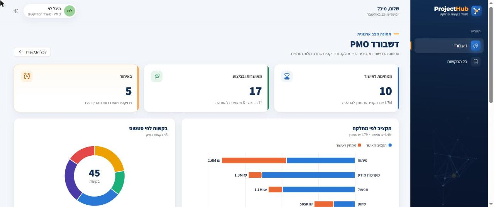
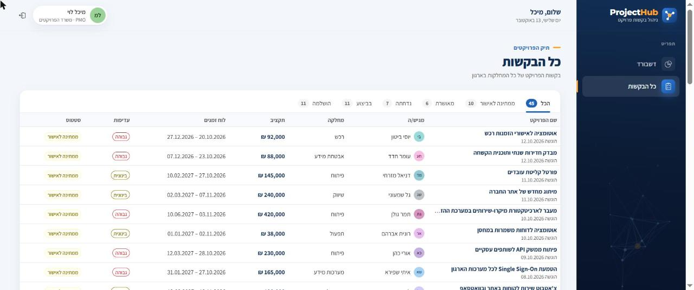
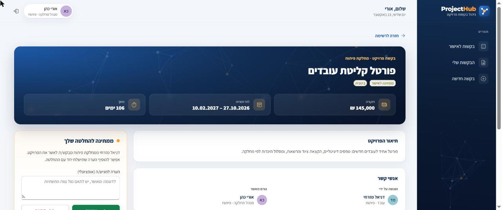
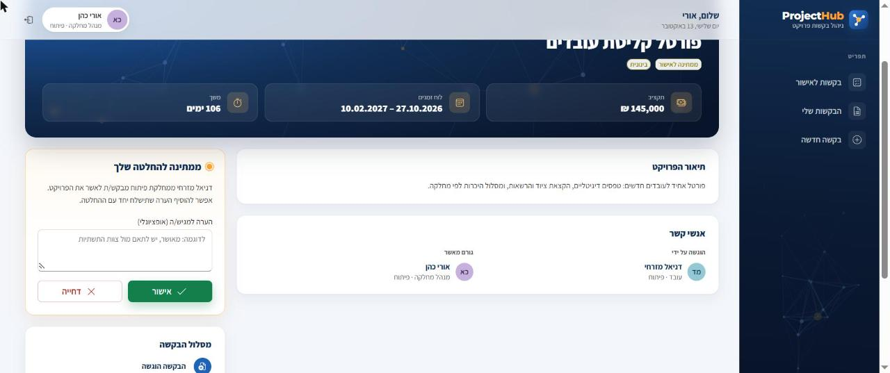
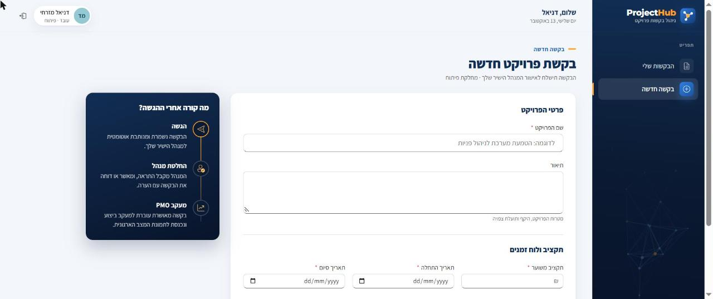
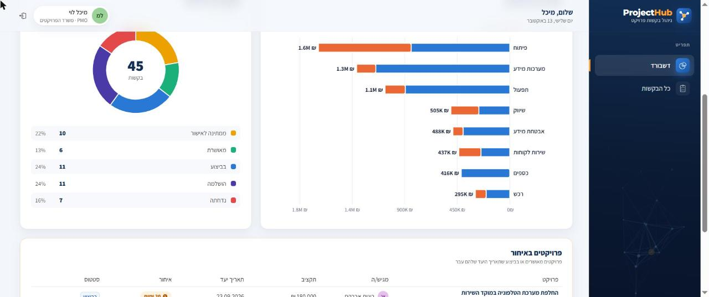
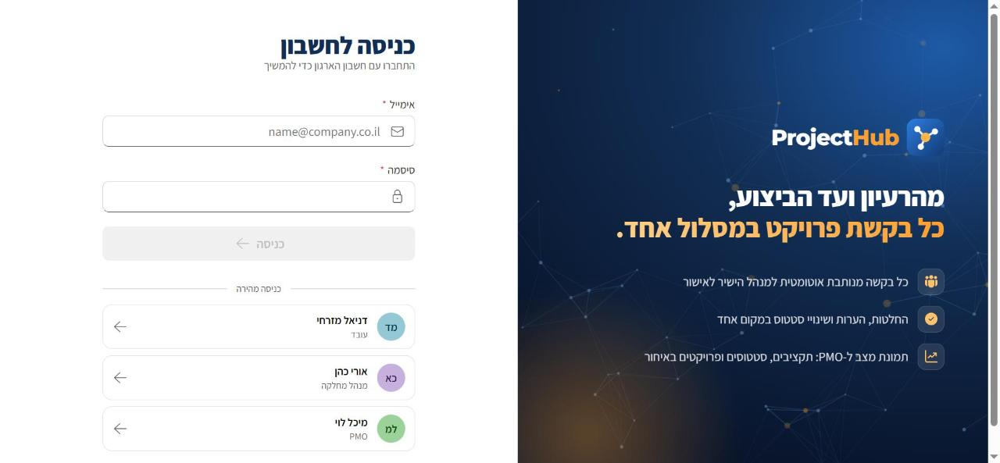
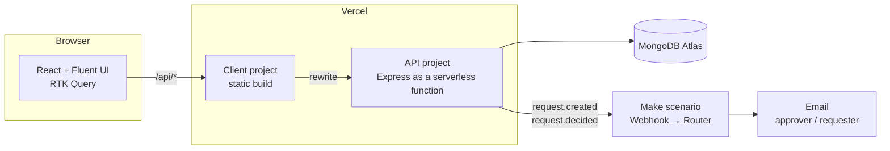

# ProjectHub

**Project request portal for PMO teams.** Employees submit project requests, their direct manager approves or rejects them, and the PMO tracks execution, budgets and overdue projects from a single dashboard.

**Live app:** https://projecthub-bice.vercel.app &nbsp;·&nbsp; Hebrew, right-to-left UI



---

## Features

- **Request intake.** A validated form for title, description, budget, schedule and priority. Each request is routed automatically to the requester's direct manager.
- **Approvals.** Managers get a "pending approval" queue, decide with an optional note, and every request carries a timeline from submission to completion.
- **Execution tracking.** The PMO moves approved projects to *in progress* and *completed*. Status changes follow a fixed workflow enforced on the server.
- **PMO dashboard.** Headline counts, approved vs. pending budget per department, requests by status, and a list of overdue projects with days late.
- **Role-based access.** Employees see their own requests, managers also see their team's, and the PMO sees everything. Permissions are enforced by the API, not only hidden in the UI.
- **Email automation.** The API emits `request.created` and `request.decided` events to a [Make](https://www.make.com) scenario that emails the approver and the requester.
- **Microsoft 365 look and feel.** Built with Fluent UI v9, fully right-to-left, with a custom brand theme.

## Screenshots

| Requests | Request details |
|---|---|
|  |  |
| **Manager decision** | **New request** |
|  |  |
| **Dashboard charts** | **Sign-in** |
|  |  |

## Tech stack

| Layer | Technology |
|---|---|
| Client | React 19, TypeScript, Vite, Fluent UI v9, Redux Toolkit + RTK Query, React Router, Recharts, CSS Modules |
| API | Node.js, Express 5, TypeScript, Mongoose, JWT, bcrypt |
| Database | MongoDB Atlas |
| Automation | Make (webhook → router → Gmail) |
| Hosting | Vercel (static client + serverless API, Frankfurt region) |

## Architecture



- The client proxies `/api/*` to the API project, so the browser talks to a single origin and no CORS setup is needed.
- The API connects to MongoDB once per function instance and reuses the connection across invocations.
- Automation runs outside the request path. If Make is unavailable, the request is still saved and the failure is logged.

## SharePoint and Microsoft 365 mapping

The data model and API were designed to map directly onto a SharePoint-based solution, so the client could move into an SPFx web part with little change.

| ProjectHub | SharePoint / Microsoft 365 |
|---|---|
| `ProjectRequest` collection | List |
| `User` + `managerId` | Microsoft Graph user + `/manager` |
| Role middleware | SharePoint permissions / groups |
| React components with Fluent UI | SPFx Web Parts with Fluent UI |
| RTK Query calls to `/api` | PnPjs calls to SharePoint REST |
| Make scenario | Power Automate flow |

## Data model

**User**: `name`, `email`, `role` (`employee` · `manager` · `pmo`), `department`, `managerId`

**ProjectRequest**: `title`, `description`, `department`, `requesterId`, `approverId`, `budget`, `startDate`, `endDate`, `priority` (`low` · `medium` · `high`), `status` (`pending` · `approved` · `rejected` · `in-progress` · `completed`), `decisionNote`, `decidedAt`, timestamps

A project is **overdue** when its end date has passed and it is still `approved` or `in-progress`.

## API

All endpoints are under `/api` and respond with `{ success: true, data }` or `{ success: false, error }`.

| Method | Path | Access | Description |
|---|---|---|---|
| `POST` | `/auth/login` | public | Returns a JWT and the user profile |
| `GET` | `/auth/me` | signed in | Current user |
| `GET` | `/requests` | signed in | Requests visible to the caller; optional `?status=` |
| `POST` | `/requests` | signed in | Creates a request and routes it to the direct manager |
| `GET` | `/requests/:id` | requester · approver · PMO | Request details |
| `PATCH` | `/requests/:id/decision` | assigned approver | `{ decision: "approved" \| "rejected", note? }`, only while pending |
| `PATCH` | `/requests/:id/status` | PMO | `approved → in-progress → completed` |
| `GET` | `/dashboard/summary` | PMO | Counts by status, budget by department, overdue projects |

## Automation

When `MAKE_WEBHOOK_URL` is set, the API posts a flat, mail-ready payload to it after a request is created or decided:

```json
{
  "event": "request.created",
  "request": {
    "title": "…", "department": "…", "budgetFormatted": "…",
    "startDate": "…", "endDate": "…", "statusLabel": "…", "decisionNote": "…", "url": "…"
  },
  "requester": { "name": "…", "email": "…" },
  "approver": { "name": "…", "email": "…" }
}
```

The Make scenario routes on `event`: `request.created` emails the approver with the request details and a link to the portal, and `request.decided` emails the requester with the decision and the manager's note.

## Project structure

```
projecthub/
├── client/                  React app
│   └── src/
│       ├── components/      App shell, badges, charts, panels
│       ├── features/        RTK Query endpoints and auth state
│       ├── pages/           Sign-in, requests, details, new request, dashboard
│       ├── store/           Redux store and base API
│       └── theme.ts         Fluent UI brand theme
├── server/                  Express API
│   ├── api/                 Vercel function entry point
│   └── src/
│       ├── controllers/     Request handlers
│       ├── middleware/      Auth, roles, errors, DB connection
│       ├── models/          Mongoose models
│       ├── routes/
│       ├── scripts/         Database seed
│       └── utils/           Access rules, JWT, Make notifications
└── docker-compose.yml       Local MongoDB
```

## Running locally

**Prerequisites:** Node.js 20+, Docker (or any MongoDB instance).

```bash
# 1. Start MongoDB
docker compose up -d

# 2. API
cd server
cp .env.example .env        # set JWT_SECRET and SEED_PASSWORD
npm install
npm run seed                # creates the seed organization and requests
npm run dev                 # http://localhost:5000

# 3. Client (in a second terminal)
cd client
npm install
npm run dev                 # http://localhost:5173
```

The seed script creates a fictional organization, **Telvora**: a PMO lead, two department managers and ten employees across eight departments, with 45 requests spread over the past year. All seed users share the password from `SEED_PASSWORD`. Useful accounts:

| Role | Email |
|---|---|
| Employee | `daniel.mizrahi@telvora.co.il` |
| Manager | `ori.cohen@telvora.co.il` |
| PMO | `michal.levi@telvora.co.il` |

To show one-click sign-in buttons for these accounts, create `client/.env.local` with `VITE_QUICK_LOGIN=true` and `VITE_QUICK_LOGIN_PASSWORD=<seed password>`.

### Environment variables (server)

| Variable | Required | Description |
|---|---|---|
| `MONGO_URI` | yes | MongoDB connection string |
| `JWT_SECRET` | yes | Secret for signing tokens |
| `JWT_EXPIRES_IN` | no | Token lifetime, default `8h` |
| `CLIENT_ORIGIN` | no | Client URL, used for CORS and links in emails |
| `SEED_PASSWORD` | for seeding | Shared password for seed users |
| `MAKE_WEBHOOK_URL` | no | Enables automation events |

## Deployment

Both apps deploy to Vercel from this repository on every push to `main`:

- **API**: Vercel project with root directory `server`. `api/index.ts` exposes the Express app as a serverless function in the Frankfurt region, next to the database.
- **Client**: Vercel project with root directory `client`. `vercel.json` rewrites `/api/*` to the API and serves `index.html` for client-side routes.
